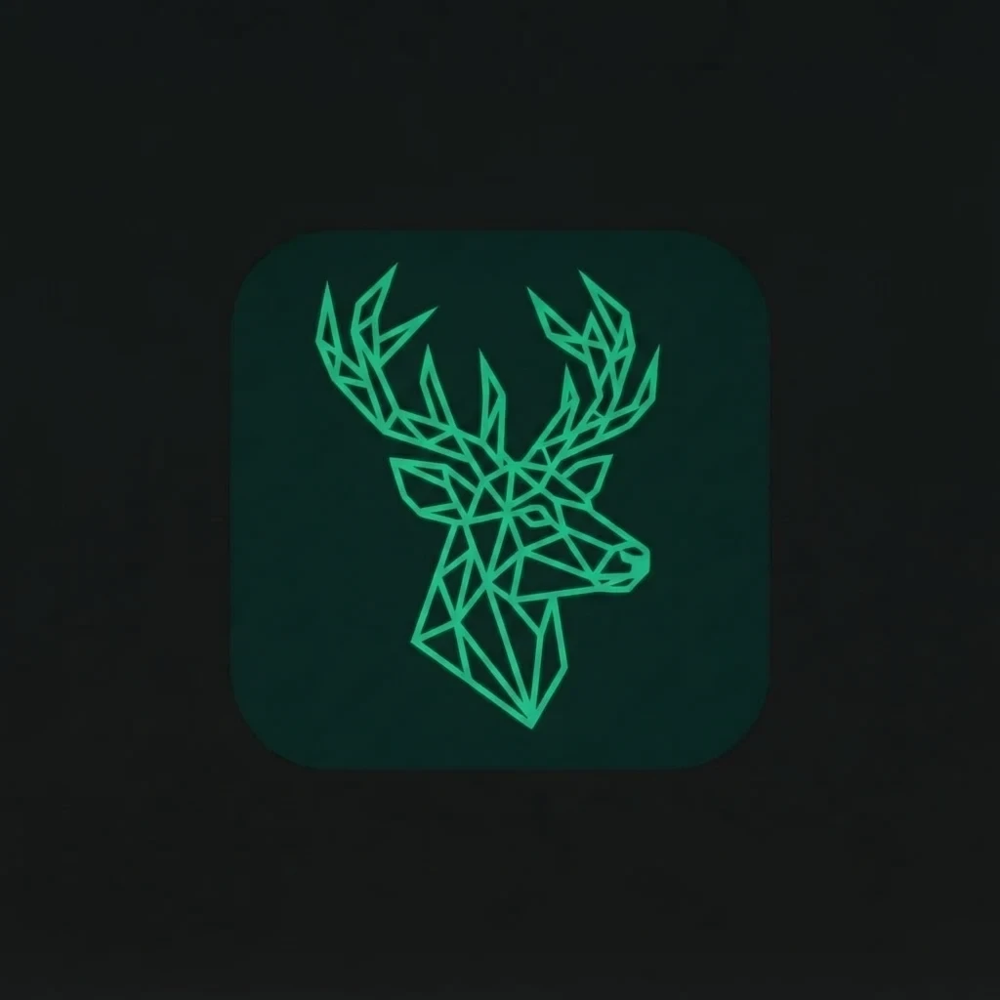
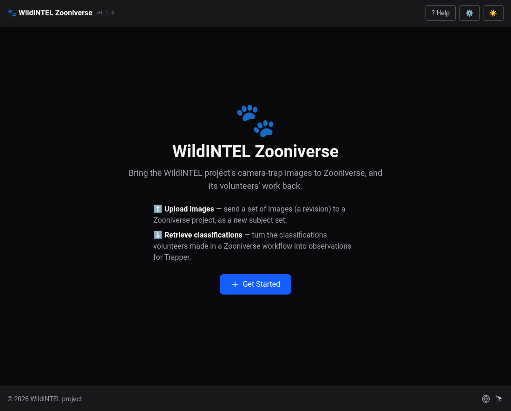
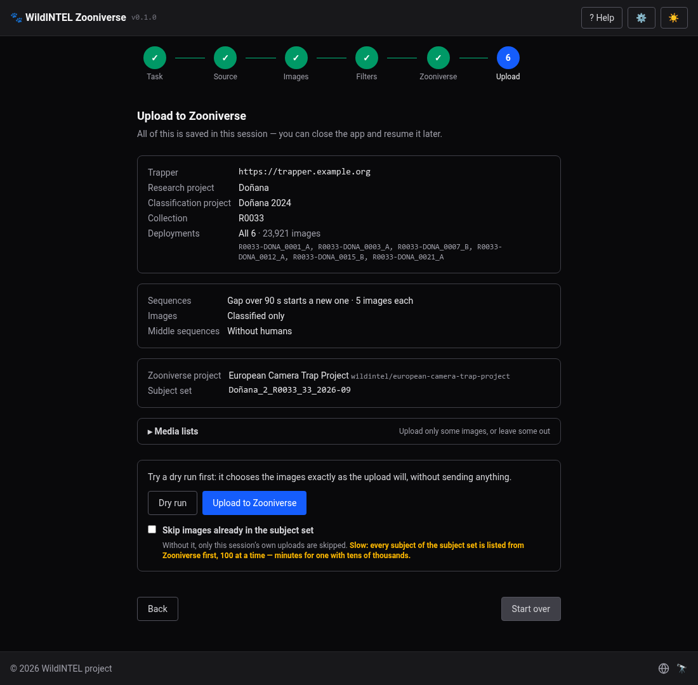
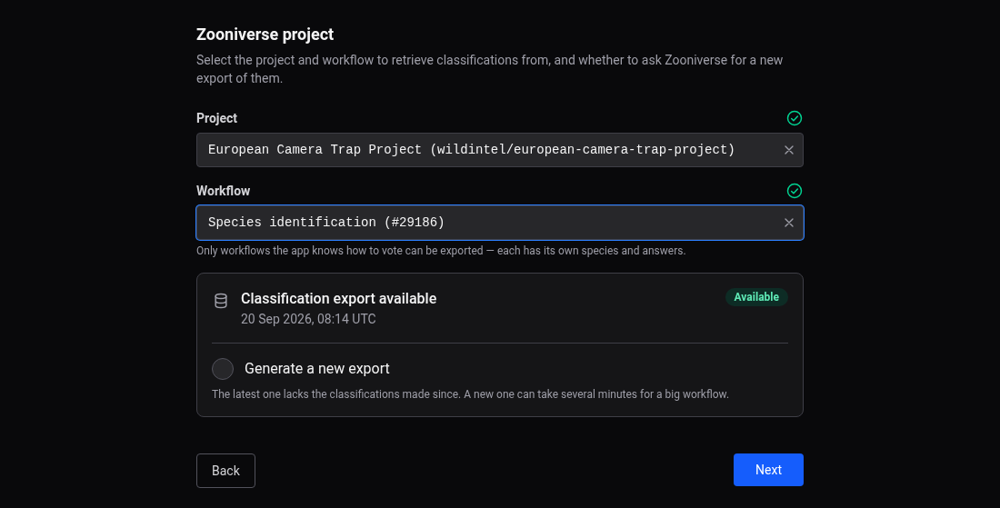
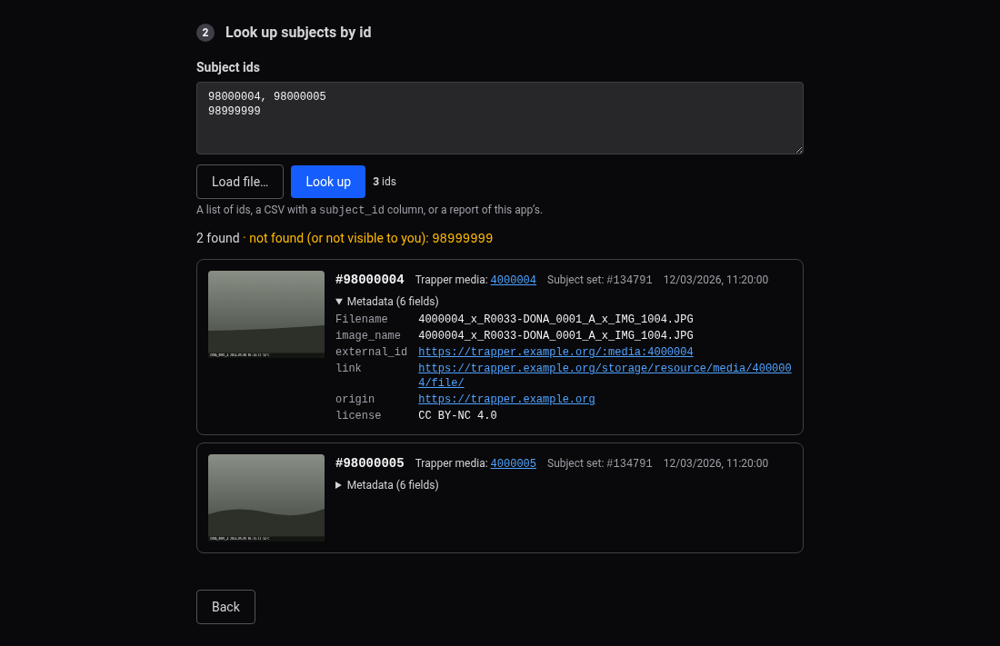

#  wildintel-zooniverse


[](https://wildintel.eu/)
[](https://gitlab.com/trapper-project/trapper)
[](https://www.zooniverse.org/)

<hr>

## Brings WildINTEL camera-trap images to Zooniverse, and its volunteers' classifications back

**wildintel-zooniverse** is an open-source application that takes camera-trap images of the
[WildINTEL](https://wildintel.eu/) project from a [Trapper](https://gitlab.com/trapper-project/trapper)
collection to a [Zooniverse](https://www.zooniverse.org/) project — choosing which images go
(sequences, sampling, humans and vehicles), with a dry run first, live progress per deployment and
resumable uploads — and brings the classifications its volunteers make back to Trapper as
observations, voted per image. It also downloads, validates and audits Zooniverse subject sets,
and rewrites their metadata.

It brings the Zooniverse features of
[wildintel-tools](https://github.com/ijfvianauhu/wildintel-tools) to a guided desktop web app, and
to a command line with wildintel-tools' own commands (`wildintel-zooniverse --help`), on the same
core, settings and sessions. It is a sibling of
[wildintel-uploader](https://github.com/wildintelproject/wildintel-uploader), with the same
architecture.

<table>
  <tr>
    <td align="center"></td>
    <td align="center"></td>
    <td align="center"></td>
    <td align="center"></td>
  </tr>
  <tr>
    <td align="center">Welcome screen</td>
    <td align="center">Upload wizard</td>
    <td align="center">Retrieve classifications</td>
    <td align="center">Subjects utility</td>
  </tr>
</table>

## 🚀 Quick start

```bash
git clone https://github.com/wildintelproject/wildintel-zooniverse.git
cd wildintel-zooniverse
./setup.sh
source .venv/bin/activate
uv run wzcli dev
```

Or, once packaged, download the executable for your platform from the
[releases page](https://github.com/wildintelproject/wildintel-zooniverse/releases) — no
installation needed.

## ✨ Features

**Uploading images to Zooniverse**

- Choose a Trapper collection the same way wildintel-tools' import wizard does — research
  project → classification project → collection → deployments
- Choose which images of it go: **sequences**, **sampling**, and removing **humans** and
  **vehicles** from the middle of each sequence
- **Preview** and **analyze sequences** before anything is uploaded, a **dry run** of the full
  upload, and the **upload** itself — resumable, with live progress per deployment

**Retrieving classifications**

- Turn a workflow's Zooniverse classifications into a CSV of observations for Trapper's
  classification import, voted per image, with every known voting quirk fixed
- Scientific names are checked against Trapper's species catalog before each file is sent

**Utilities**

- Download a subject set's images to a local folder
- Validate and audit a subject set against its Trapper collection: duplicated media, unmatched
  subjects, metadata issues, and missing or extra images
- Browse subjects and rewrite a subject set's metadata from its Trapper collection

**General**

- A guided web app and a smaller command line (`wildintel-zooniverse`), on the same core,
  settings and sessions, so an upload started in one can be resumed in the other
- Sessions are kept on disk, so an unfinished upload is offered back when the app starts
- One executable per platform, or a development mode with hot reload

## 📋 Requirements

**To run it**

- Python 3.12+ with [uv](https://docs.astral.sh/uv/)
- Node.js 18+ (20 in CI) / npm (to build the frontend)
- The [Trapper SDK](https://github.com/wildintelproject/wildintelproject-trapper-sdk), which
  `setup.sh` clones next to this repository
- Access to a Trapper account and a Zooniverse project you own or collaborate on

**Technology stack**

| Layer | Technologies |
|---|---|
| Backend | [FastAPI](https://fastapi.tiangolo.com/) served by [Uvicorn](https://www.uvicorn.org/), [Pydantic](https://docs.pydantic.dev/) 2, [Dynaconf](https://www.dynaconf.com/) (settings), [tenacity](https://tenacity.readthedocs.io/) (retries) |
| Command line | [Typer](https://typer.tiangolo.com/) and [Rich](https://rich.readthedocs.io/) |
| Integrations | WildINTEL's Trapper SDK, [panoptes-client](https://github.com/zooniverse/panoptes-python-client) (Zooniverse/Panoptes API) |
| Frontend | [React](https://react.dev/) 19, [TypeScript](https://www.typescriptlang.org/), [Vite](https://vite.dev/), [Tailwind CSS](https://tailwindcss.com/) 4 |
| Testing and quality | [pytest](https://pytest.org/), [Vitest](https://vitest.dev/), [oxlint](https://oxc.rs/docs/guide/usage/linter) |
| Packaging and docs | [PyInstaller](https://pyinstaller.org/) (executables), [MkDocs Material](https://squidfunk.github.io/mkdocs-material/) with mike, GitHub Actions |

## 📚 Documentation

Full documentation is available at **https://wildintelproject.github.io/wildintel-zooniverse/**

## 🤝 Contributing

Contributions are welcome! Please feel free to submit a Pull Request.

To report a bug or request a new feature, please open an
[issue](https://github.com/wildintelproject/wildintel-zooniverse/issues).

## 🏛️ Funding

This work is part of the [WildINTEL project](https://wildintel.eu/), funded by the [Biodiversa+](https://www.biodiversa.eu/) Joint Research Call 2022-2023 "Improved
transnational monitoring of biodiversity and ecosystem change for science and society (BiodivMon)". Biodiversa+ is the
European co-funded biodiversity partnership supporting excellent research on biodiversity with an impact for policy and
society. Biodiversa+ is part of the European Biodiversity Strategy for 2030 that aims to put Europe's biodiversity on a
path to recovery by 2030 and is co-funded by the European Commission.

WildINTEL has been co-funded by the [European Commission](https://commission.europa.eu/) (GA No. 101052342) and the following funding organisations: [Agencia Estatal de Investigación](https://www.aei.gob.es/) (Spain, PCI2023-145963-2, PCI2024-153489), [National Science Centre](https://www.ncn.gov.pl/?language=en) (Poland, UMO-2023/05/Y/NZ8/00104), the [Research Council of Norway](https://www.forskningsradet.no/en/) (Norway, NFR350962) and the [German Research Foundation](https://www.dfg.de/en/) (Germany).

## 📝 License

This project is licensed under the GNU General Public License v3.0 or later - see the [LICENSE](LICENSE) file for details.

This program is free software: you can redistribute it and/or modify it under the terms of the GNU General Public License
as published by the Free Software Foundation, either version 3 of the License, or (at your option) any later version.
